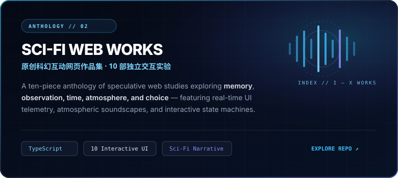
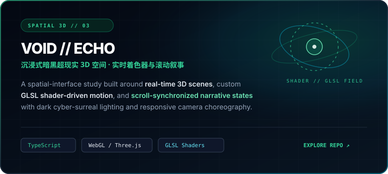
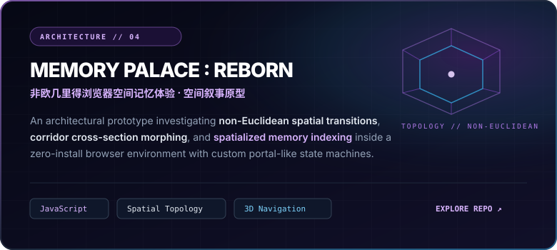
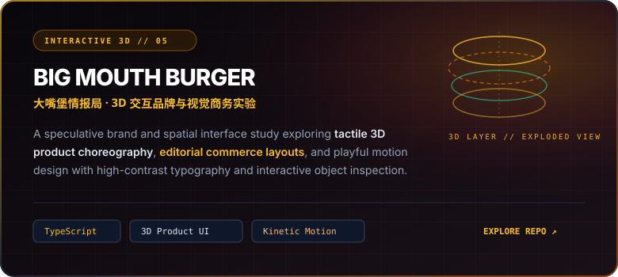
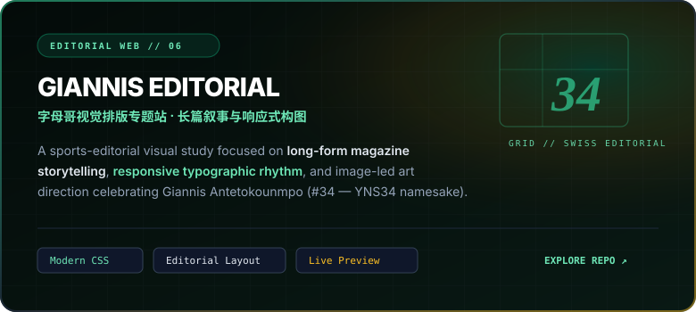
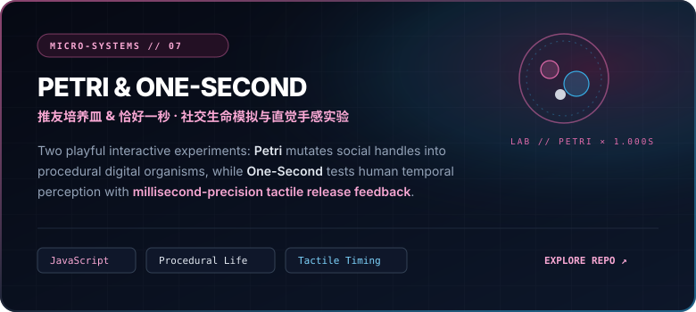
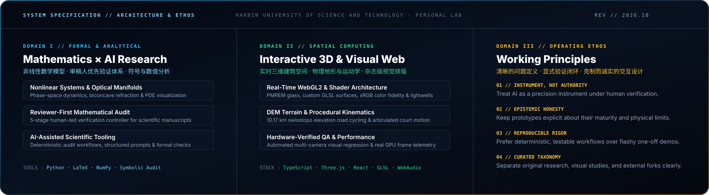
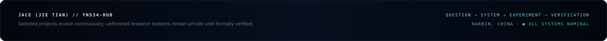

<!-- ===================================================================== -->
<!-- 00 // ARCHITECTURAL HERO MONOLITH                                     -->
<!-- ===================================================================== -->

 

  <a href="https://yns34-hub.github.io/"><b>🌐 LIVE WORLD (YNS34-HUB.GITHUB.IO)</b></a>
  &nbsp;·&nbsp;
  <a href="https://yns34-hub.github.io/museum/"><b>🏛️ 3D MUSEUM</b></a>
  &nbsp;·&nbsp;
  <a href="https://yns34-hub.github.io/alpine-ride/"><b>🏔️ ALPINE DESCENT (10.17 KM)</b></a>
  &nbsp;·&nbsp;
  <a href="https://yns34-hub.github.io/giannis-fansite/"><b>🏀 GIANNIS EDITORIAL</b></a>
  &nbsp;·&nbsp;
  <a href="mailto:1104643717wxy@gmail.com"><b>✉️ CONTACT</b></a>

  

<!-- ===================================================================== -->
<!-- 01 // FLAGSHIP INTERACTIVE WORLD : THE MEMORY PALACE                  -->
<!-- ===================================================================== -->

  

<!-- ===================================================================== -->
<!-- 02 // SELECTED WORKS & INTERACTIVE BENTO EXHIBITION (3 × 2 GRID)      -->
<!-- ===================================================================== -->

  &nbsp;

  &nbsp;

  &nbsp;

 

<!-- ===================================================================== -->
<!-- 03 // SYSTEM ARCHITECTURE, RESEARCH DOMAINS & WORKING PRINCIPLES      -->
<!-- ===================================================================== -->

  

<!-- ===================================================================== -->
<!-- 04 // COLOPHON & SIGNATURE                                            -->
<!-- ===================================================================== -->

