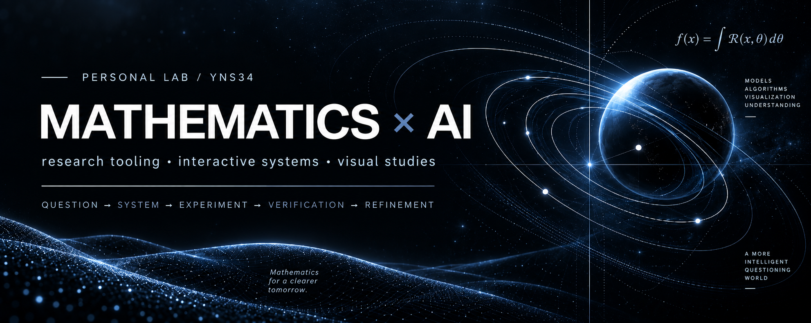
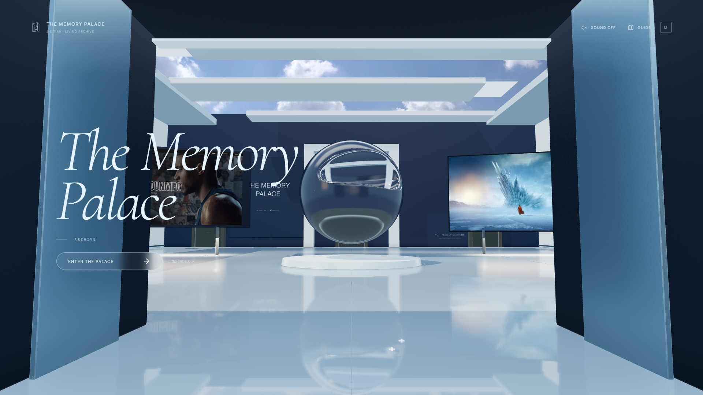
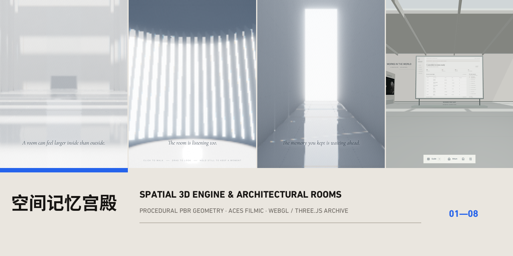
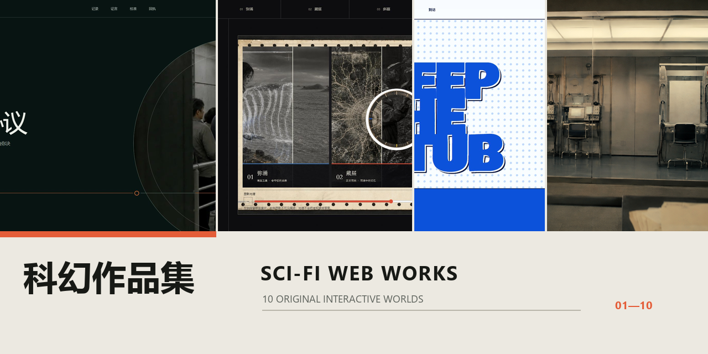
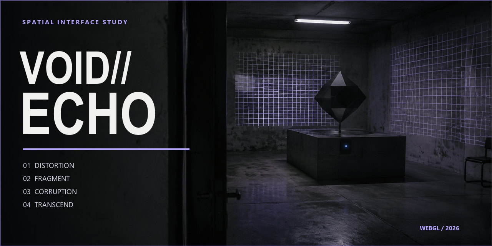
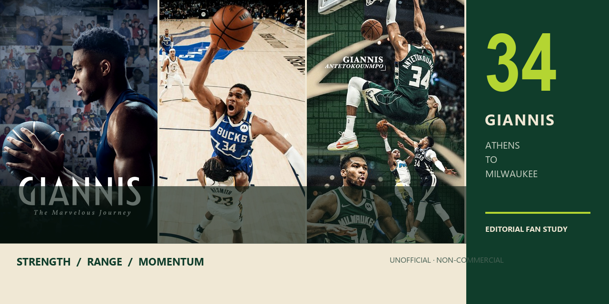
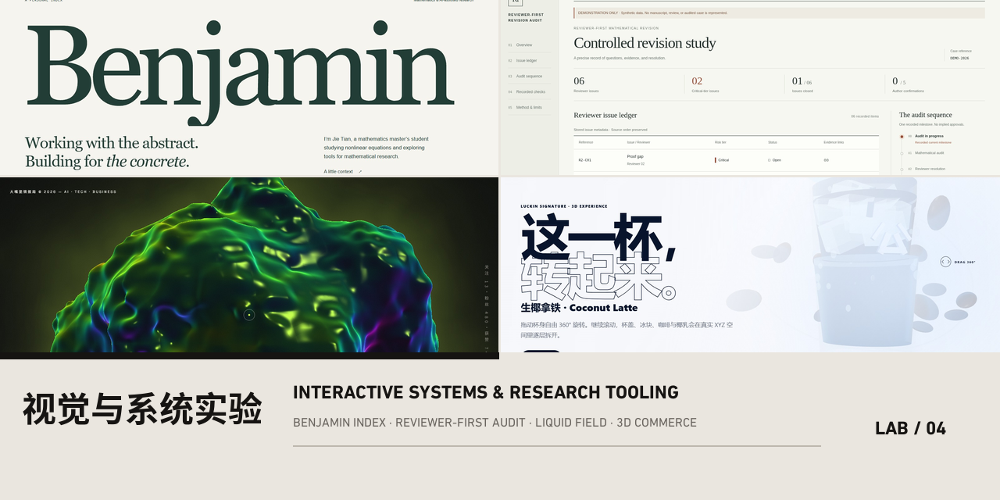

<!-- 00 · HERO MONOGRAPH -->

 

<h3>
  <b>JIE TIAN · 田杰</b> &nbsp;—&nbsp; <i>Working with the abstract. Building for the concrete.</i>
</h3>

  <b>Nonlinear Mathematics</b> &nbsp;·&nbsp; <b>AI-Assisted Reasoning</b> &nbsp;·&nbsp; <b>Spatial 3D Web Systems</b> &nbsp;·&nbsp; <b>Editorial Interactive Art</b>

  <a href="https://yns34-hub.github.io"><b>↗ ENTER THE MEMORY PALACE (3D LIVE EXHIBITION)</b></a>
  &nbsp;&nbsp;·&nbsp;&nbsp;
  <a href="https://github.com/YNS34-hub/YNS34-hub.github.io"><b>SOURCE ARCHIVE</b></a>
  &nbsp;&nbsp;·&nbsp;&nbsp;
  <a href="https://github.com/YNS34-hub?tab=repositories"><b>INDEX OF WORKS</b></a>

---

### `01` &nbsp; FLAGSHIP MONOGRAPH — *The Memory Palace*

> **A walk-through 3D architectural archive built natively for the browser.**  
> Eight interconnected spatial rooms—from the refractive marble *Atrium* and *Infinite Corridor* to physical *Alpine Cycling* and *Street Basketball* worlds—rendered with custom procedural PBR geometry, ACES Filmic tone mapping, and spatial acoustics.

  
    
  

 

---

### `02` &nbsp; SELECTED WORKS IN THE WORLD — *Curated Exhibition*

<table>
  <tr>
    <td width="50%" valign="top">
      
        
      <b>01 · <a href="https://github.com/YNS34-hub/YNS34-hub.github.io">YNS34-hub.github.io</a></b> &nbsp; <code>THREE.JS</code> <code>WEBGL</code> <code>GSAP</code> 
      <b>The Memory Palace & Personal Lab</b> — Non-linear mathematical research index and 8-room 3D interactive museum archive.
       
      <a href="https://yns34-hub.github.io"><b>↗ Live Exhibition</b></a> &nbsp;·&nbsp; <a href="https://github.com/YNS34-hub/YNS34-hub.github.io"><b>Repository</b></a>
    </td>
    <td width="50%" valign="top">
      
        
      <b>02 · <a href="https://github.com/YNS34-hub/antigravity">antigravity</a></b> &nbsp; <code>TYPESCRIPT</code> <code>REACT 19</code> <code>PBR SHADERS</code> 
      <b>Spatial 3D Engine & Architectural Rooms</b> — Procedural museum geometry, acoustic mirror rooms, and zero-external-model rendering pipeline.
       
      <a href="https://github.com/YNS34-hub/antigravity"><b>↗ Explore Engine</b></a>
    </td>
  </tr>
  <tr>
    <td width="50%" valign="top">
       
      
        
      <b>03 · <a href="https://github.com/YNS34-hub/sci-fi-portfolio">sci-fi-portfolio</a></b> &nbsp; <code>10 WORLDS</code> <code>CANVAS 2D</code> <code>WEB AUDIO</code> 
      <b>科幻作品集 · Sci-Fi Web Works</b> — Ten original speculative interactive worlds exploring non-linear time, memory calibration, and orbital acoustics.
       
      <a href="https://yns34-hub.github.io/sci-fi-portfolio/"><b>↗ Launch Anthology</b></a> &nbsp;·&nbsp; <a href="https://github.com/YNS34-hub/sci-fi-portfolio"><b>Repository</b></a>
    </td>
    <td width="50%" valign="top">
       
      
        
      <b>04 · <a href="https://github.com/YNS34-hub/void-echo">void-echo</a></b> &nbsp; <code>NEXT.JS 16</code> <code>TAILWIND V4</code> <code>3D GALLERY</code> 
      <b>VOID//ECHO · 虚空回响</b> — Brutalist speculative-fiction exhibition space with real-time signal decay, terminal telemetry, and darkroom lighting.
       
      <a href="https://github.com/YNS34-hub/void-echo"><b>↗ Enter Archive</b></a>
    </td>
  </tr>
  <tr>
    <td width="50%" valign="top">
       
      
        
      <b>05 · <a href="https://github.com/YNS34-hub/big-mouth-burger">big-mouth-burger</a></b> &nbsp; <code>NEXT.JS 16</code> <code>GSAP SCROLL</code> <code>3D CRAFT</code> 
      <b>大嘴堡情报局 · Big Mouth Burger</b> — High-contrast editorial food campaign lookbook paired with scroll-driven 3D ingredient deconstruction.
       
      <a href="https://big-mouth-burger.vercel.app"><b>↗ Live Flagship</b></a> &nbsp;·&nbsp; <a href="https://github.com/YNS34-hub/big-mouth-burger"><b>Repository</b></a>
    </td>
    <td width="50%" valign="top">
       
      
        
      <b>06 · <a href="https://github.com/YNS34-hub/giannis-fansite">giannis-fansite</a></b> &nbsp; <code>EDITORIAL</code> <code>MOTION</code> <code>TYPOGRAPHY</code> 
      <b>34 GIANNIS · Athens to Milwaukee</b> — Magazine-grade sports monograph chronicling strength, range, and championship momentum.
       
      <a href="https://github.com/YNS34-hub/giannis-fansite"><b>↗ View Monograph</b></a>
    </td>
  </tr>
</table>

 

---

### `03` &nbsp; INTERACTIVE SYSTEMS & RESEARCH TOOLING — *Visual Studies*

  

 

| Domain | Focus & Methodology | Core Stack |
| :--- | :--- | :--- |
| **Nonlinear Mathematics & Revision Control** | Formalizing complex dynamical systems, reviewer-first mathematical proof auditing, and structured issue ledgers. | `LaTeX` · `Python` · `Symbolic Verification` |
| **Spatial 3D Web Architecture** | Procedural architectural geometry, physically based rendering (PBR), ACES Filmic lighting, and 60fps camera physics. | `Three.js` · `WebGL / GLSL` · `GSAP` |
| **Editorial Interface Systems** | Swiss-grid typographic hierarchy, tactile film grain, choreographed scroll narratives, and responsive design tokens. | `Next.js 16` · `React 19` · `TypeScript` · `Tailwind v4` |
| **Automated Quality Verification** | Deterministic end-to-end visual regression auditing, Playwright browser gates, and zero-warning build pipelines. | `Playwright` · `ESLint 9` · `GitHub Actions` |

 

---

  <b>JIE TIAN (YNS34)</b> &nbsp;·&nbsp; MATHEMATICS FOR A CLEARER TOMORROW &nbsp;·&nbsp; <a href="https://yns34-hub.github.io">YNS34-HUB.GITHUB.IO</a>

